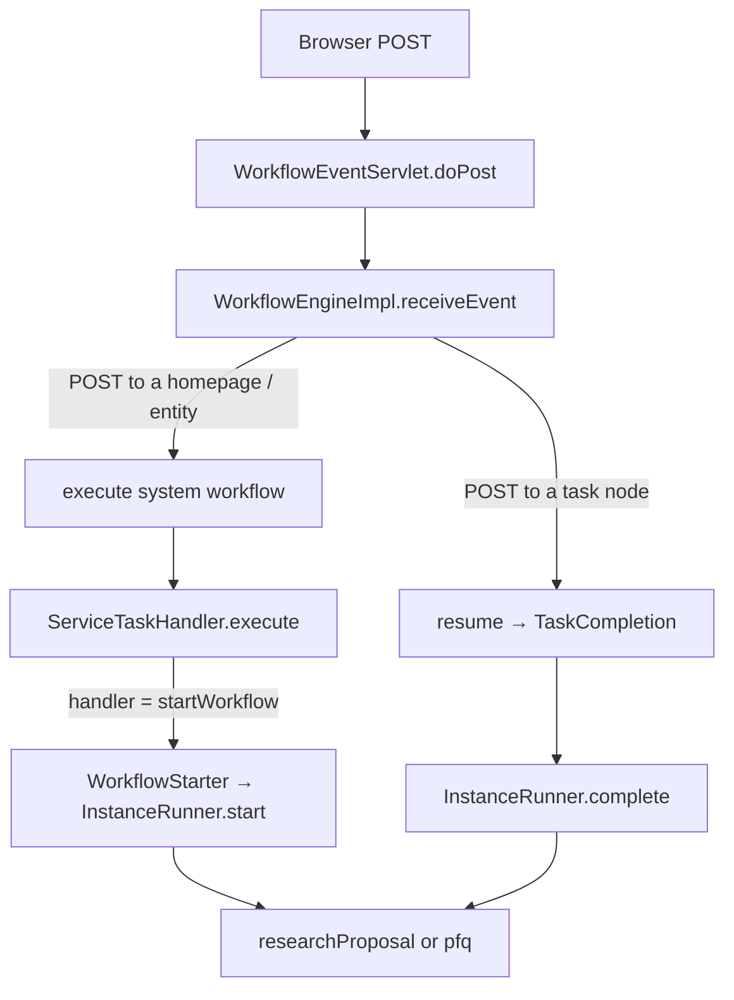
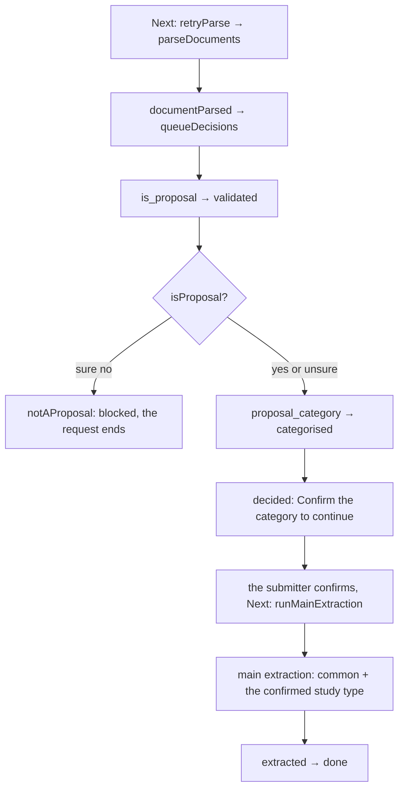

# Who calls whom during a research-proposal submission

Every POST into a submission goes through one door. After that the engine either runs a **system workflow** straight through (no instance, no wait) or **resumes / starts** a user workflow that can park on a user task and branch at a gateway.

The code below is trimmed to the lines that matter, so it does not match the files line for line.



---

## 0. The door: how a POST becomes an event

The UI never calls a handler. It POSTs a path. Sling routes that to `WorkflowEventServlet`.

`modules/workflows/src/main/java/io/uhndata/iap/workflows/internal/WorkflowEventServlet.java`:

```java
    @Override
    protected void doPost(final SlingJakartaHttpServletRequest request,
        final SlingJakartaHttpServletResponse response) throws IOException
    {
        try {
            final String name = eventName(request);
            final WorkflowResult result =
                this.engine.receiveEvent(request.getResource(), new WorkflowEvent(name, payload(request)));
```

The event name is decided here:

`modules/workflows/src/main/java/io/uhndata/iap/workflows/internal/WorkflowEventServlet.java`:

```java
    private String eventName(final SlingJakartaHttpServletRequest request)
    {
        final String named = request.getRequestPathInfo().getSelectorString();
        if (named != null && !named.isEmpty()) {
            return named;
        }
        final Resource target = request.getResource();
        if (target.isResourceType(TaskInstance.RESOURCE_TYPE)) {
            return TaskCompletion.COMPLETE_EVENT;
        }
        return target.isResourceType(SUBMISSION_RESOURCE_TYPE) ? SAVE_EVENT : CREATE_EVENT;
    }
```

| POST | Event | Why |
| --- | --- | --- |
| `POST /Submissions` | `create` | homepage, no selector |
| `POST /Submissions/.../abc` | `save` | a submission, no selector |
| `POST /Submissions/.../abc.attachDocument.json` | `attachDocument` | selector |
| `POST /Submissions/.../abc.readAgain.json` | `readAgain` | selector |
| `POST /Submissions/.../abc/wf:instances/.../task` | `complete` | a task node |

The engine then forks:

`modules/workflows/src/main/java/io/uhndata/iap/workflows/internal/WorkflowEngineImpl.java`:

```java
    public WorkflowResult receiveEvent(final Resource target, final WorkflowEvent event) throws WorkflowException
    {
        // ...
            if (privilegedTarget.isResourceType(TaskInstance.RESOURCE_TYPE)) {
                return resume(privilegedTarget, event, actor);
            }
            final StartEvent start = SystemWorkflowLocator.find(serviceResolver, target, event);
            PerformerCheck.verify(this.principals, serviceResolver, privilegedTarget, start, actor);
            return execute(privilegedTarget, event, start, actor);
```

- **Task node** → `resume` → `TaskCompletion.apply` → `InstanceRunner.complete`.
- **Anything else** → find a system workflow whose start `messageName` matches the event, then `execute` walks it node by node and dispatches each `handler` in `perform`.

`startWorkflow` is special-cased inside `perform` — it is the engine itself, not a registered handler:

`modules/workflows/src/main/java/io/uhndata/iap/workflows/internal/WorkflowEngineImpl.java`:

```java
    private void perform(final Activity activity, final WorkflowTaskContext context)
    {
        final String name = activity.getHandler();
        // ...
        if (WorkflowStarter.HANDLER_NAME.equals(name)) {
            WorkflowStarter.execute(context, performer(...), this.conditions, this.principals);
            return;
        }
        // else look up ServiceTaskHandler by name and call handler.execute(context)
```

---

## 1. Create the submission

**UI** `NewSubmissionDialog` POSTs title + schema version to `/Submissions`:

`modules/submissions/impl/src/main/frontend/src/NewSubmissionDialog.tsx`:

```tsx
  const submit = useCallback(() => {
    setSubmitting(true);
    setSubmitError(undefined);
    doFetch("/Submissions", {
      method: "POST",
      body: new URLSearchParams({ title: title.trim(), schemaVersion: selected }),
    })
```

That is `create`. The definition that answers it is `createSubmission`:

`modules/submissions/api/src/main/resources/SLING-INF/content/SystemWorkflows/createSubmission.json`:

```json
    "requested": { "messageName": "create", ... "targetRef": "create" },
    "create":           { "handler": "createSubmission" },
    "markCompleteness": { "handler": "markCompleteness" },
    "start":            { "handler": "startWorkflow", "workflowFrom": "schemaVersion/workflow" },
```

Straight-through walk:

1. **`createSubmission`** → `CreateSubmissionHandler` makes a `sub:Submission` under `/Submissions`, tags it `draft`, points it at the schema version, stores the new path as `CREATED_PATH`:

`modules/submissions/impl/src/main/java/io/uhndata/iap/submissions/internal/CreateSubmissionHandler.java`:

```java
    public void execute(final WorkflowTaskContext context) throws WorkflowException, PersistenceException
    {
        // ... title required ...
        final Resource created = context.getResourceResolver().create(bucketFor(context, name),
            name, Map.of("jcr:primaryType", "sub:Submission", TITLE, title, "tags", new String[] {DRAFT}));
        setSchemaVersion(created, version);
        context.setVariable(WorkflowResult.CREATED_PATH_VARIABLE, created.getPath());
    }
```

2. **`markCompleteness`** → `MarkCompletenessHandler` puts or removes the `incomplete` tag from required forms/documents the author still owes:

`modules/submissions/impl/src/main/java/io/uhndata/iap/submissions/internal/MarkCompletenessHandler.java`:

```java
    public void execute(final WorkflowTaskContext context) throws WorkflowException, PersistenceException
    {
        // ...
        if (!missing(submission).isEmpty()) {
            taggable.tag(INCOMPLETE, true);
        } else {
            taggable.untag(INCOMPLETE, true);
        }
    }
```

3. **`startWorkflow`** → `WorkflowStarter` follows `schemaVersion/workflow` (for the research-proposal demo that is `researchProposal`) and `InstanceRunner.start`s it on the new submission:

`modules/workflows/src/main/java/io/uhndata/iap/workflows/internal/WorkflowStarter.java`:

```java
        final Resource host = ExecutionHost.of(context);
        final Resource versionResource = follow(resolver, host, (String) chain);
        if (versionResource == null || !versionResource.isResourceType(WorkflowVersion.RESOURCE_TYPE)) {
            return;
        }
        // ...
        new InstanceRunner(...)
            .start(host, version);
```

The servlet then redirects the browser to that created path.

---

## 2. `researchProposal` waits at the intake

The *New submission* dialog lists the top categories (`/Categories/Proposal`, `/Categories/PFQ`). Each
names the schema version its submissions answer, and that path is what the dialog POSTs.

`researchProposal` is a **user** workflow (it has an instance). It opens with the intake:

```
demos/research-proposal/src/main/resources/SLING-INF/content/Workflows/researchProposal.json
    "created"       → "checkProposal" // user task, performer iap-extraction: wait for the check
    "checkProposal" → "isProposal"    // gateway on the validation operand
    "isProposal"    → "notAProposal"  // validation is_proposal equals no: the request ends
                    → "complete"      // default: user task, @creator, send for review
    "complete"      → "review"
```

`InstanceRunner.start` walks from `created` and **stops at `checkProposal`**. Only the extraction
job can complete that task: its performer is the `iap-extraction` service user. It waits at a task
because the engine cannot yet deliver a message to a catching event.

---

## 3. Step one: upload, then Next sends the documents

The editor shows a request whose documents are read in three steps (`IntakeSteps`, `intake.ts`). The
first shows only the documents. **Next** waits until each required one is uploaded, saying "Please
upload the research proposal." until then.

**Upload** — `attachDocument`:

```ts
// modules/submissions/impl/src/main/frontend/src/submissionForm.ts
export async function attachDocument(
  doFetch: AuthenticatedFetch, path: string, requirement: string, file: File): Promise<void> {
  const body = new FormData();
  body.append("requirement", requirement);
  body.append("file", file);
  const response = await doFetch(`${path}.attachDocument.json`, { method: "POST", body });
```

The `attachDocument` system workflow stores the document version (`AttachDocumentHandler` refuses
anyone but the creator, a submission that is not a draft, a wrong type or a file too big), creates
its parts and marks completeness. It parses nothing.

**Next** — `sendDocuments` fires `retryParse`, whose one step is `parseDocuments`:

```java
// modules/extraction/src/main/java/io/uhndata/iap/extraction/internal/ParseDocumentsHandler.java (trimmed)
        SubmitterAccess.checkMayChange(submission, context.getActor());
        ReadingRequests.checkNotBlocked(target);   // a rejected request is not read again
        for (final File file : SubmissionFiles.getFilesToParse(submission)) {
            // only an upload never sent, or one whose parse failed
            if (resource != null && queue(resource, file)) { queued++; }
        }
        if (queued > 0) {
            ExtractionStatus.recordStatus(target, ExtractionStatus.STATUS_RUNNING, null);
            ExtractionStatus.releaseClaim(target);
        }
```

Every upload is parsed unless its requirement sets `skipParsing`. `queue` stages the bytes on the
shared volume and asks `ParseService` to enqueue a Sling job; the daemon is not waited on. From then
on the editor locks the uploads, unless a parse failed: the intake reads each document once.

Saving answers is the same pattern: `POST <submission>` (no selector) → event `save` →
`SaveAnswersHandler`.

---

## 4. Daemon and callback (out of the workflow engine)

`ParseJobConsumer` takes the Sling job and POSTs `POST /parse?path=&job_id=` to Docling on :18765. The
daemon answers "queued" immediately.

When Docling finishes it POSTs `/system/documents/parseCallback`. `ParseCallbackServlet` records the
outcome; `ParseOutcomeDispatcher` hands it to whoever claims that file. For a submission file that is
`ParseCompletionHandler`, which fires `documentParsed` on the submission.

---

## 5. `documentParsed` → ingest, then queue the checks

```
modules/extraction/src/main/resources/SLING-INF/content/SystemWorkflows/documentParsed.json
    "parsed" → "ingest"   // ingestParse: Markdown, PDF and tokens onto the file, or the failure
    "ingest" → "queue"    // queueDecisions: a Sling job on iap/extraction/decide
```

`queueDecisions` queues a job for every parse, failed or not, so a submission whose documents land
together queues several. The first does the checks and ends the reading; the others find it ended and
drop out.

---

## 6. The decision job: each document's checks, in document order

`DecisionJobConsumer`, on the `iap-extraction` queue (one job at a time). `ReadingJobs.run` does what
every reading job shares:

| Condition | Job result | Meaning |
| --- | --- | --- |
| No path, or submission gone | CANCEL | drop |
| A parse still unsettled | FAILED | Sling runs it again later |
| The reading is no longer `running` (another job or a Stop ended it) | CANCEL | drop, without claiming |
| A required document still to be checked is missing, or its parse failed | CANCEL | `failed`, "The research proposal is missing, please upload it" |
| Another job holds the claim | CANCEL | leave it |
| A step throws | CANCEL | `readingFailed`: `failed`, claim released |

Then, one decision at a time:

```java
// modules/extraction/src/main/java/io/uhndata/iap/extraction/internal/DecisionJobConsumer.java (trimmed)
        final List<DecisionRequirement> pending = DecisionChain.getPendingDecisions(...);
        // One round per decision, and a last one that ends the chain
        for (int next = 0; next <= pending.size(); next++) {
            resolver.refresh();
            if (current == null || next > 0 && !ExtractionStatus.isRunning(current)) {
                return;   // a no or a Stop ended the reading
            }
            if (next == pending.size()) {
                finish(current, jobId);
            } else if (!decide(current, jobId, pending.get(next))) {
                return;
            }
        }
```

`DecisionChain` orders the decisions by document, and within one document the validation first. The
two calls about the proposal come back to back, so the second reuses the model's prompt cache.

```
demos/research-proposal/src/main/resources/SLING-INF/content/Schemas/researchProposal.json
    "is_proposal":       sch:ValidationRequirement, document "proposal", template.md = the protocol structure
    "category":          sch:FormRequirement holding "kind", options from /Categories/Proposal
    "proposal_category": sch:ClassificationRequirement, document "proposal", question -> category/kind
```

### 6a. The validation → `validated` → the intake goes on or ends

`DocumentValidator` asks one yes or no question with the requirement's `prompt` and template, then
fires `validated`. Its `recordValidation` step saves the run under the submission's `sub:Validation`:

| Verdict | `recordValidation` | The intake's gateway |
| --- | --- | --- |
| `no` (sure) | `done`, blocked, "Unable to identify the research proposal"; claim released | `notAProposal`: the request ends |
| `yes` | the reading goes on | `complete` |
| `unsure` (below `confidenceThreshold`) | the reading goes on | `complete` |

Then `handOver` completes the open task whose performers include `iap-extraction`:

```java
// modules/extraction/src/main/java/io/uhndata/iap/extraction/internal/DocumentValidator.java (trimmed)
        final Resource task = findWaitingTask(submission);
        if (task == null) {
            giveUpIfRunning(submission, jobId, ReadingJobs.NOT_SET_UP_MESSAGE);   // and tell an administrator
            return false;
        }
        this.engine.receiveEvent(task, new WorkflowEvent(COMPLETE_EVENT, Map.of()));
```

The gateway `isProposal` reads the verdict through the `validation` operand
(`ValidationOperandResolver`): `yes`, `no` or `unsure`.

### 6b. The categorisation → `categorised`

`DocumentCategoriser` asks the `kind` question with the classification's `prompt`. A pick that is one
of the categories, at least as sure as `confidenceThreshold`, is saved as a suggestion on the answer to
`category/kind`. Anything else is saved as not found: the model must not guess. The answer's value
stays empty either way.

### 6c. `decided`

Once nothing is pending, the job fires `decided`. Its `finishDecisions` step sets `done`, with
"Confirm the category to continue" while the category is not confirmed, and releases the claim.

---

## 7. Step two: confirm the kind of study, then Next reads the rest

The editor's second step shows the `category` form (the form says `confirmsCategory`) under the
reading banner. **Next** waits until the checks are `done`, the request is not blocked, and `kind`
has an answer, then fires `runMainExtraction` (performer `@creator`):

```java
// modules/extraction/src/main/java/io/uhndata/iap/extraction/internal/QueueMainExtractionHandler.java
        ReadingRequests.checkMayRead(target, submission, context.getActor());   // running or blocked: 409
        ReadingRequests.checkCategoryConfirmed(submission);
        if (FormsToRead.getFormsToRead(submission).isEmpty()) {
            return;   // nothing left to read
        }
        this.requests.queue(target, MainExtractionJobConsumer.JOB_TOPIC);
```

`MainExtractionJobConsumer` reads each form that applies and names its documents, in schema order:
`common`, then `prospective` or `retrospective`, whose conditions read the confirmed `category/kind`
through the `answer` source. Each asks only its questions with an `extractionPrompt` that nobody
answered and the model never read, at most ten per call. The job fires `extracted`, whose
`recordExtraction` step saves one run per question asked, found or not, and sets `done`.



`pfq` is the same shape with one validation, `is_questionnaire`, and no category: its second step
only waits for the check, and the `extracted` form is read out of the preamble and the questionnaire
together.

---

## 8. Step three: check the answers, send for review

Each suggestion is shown framed beside its quotes, and is saved only once the submitter confirms or
edits it. `researchProposal` is on `complete` ("Send for review"). Completing that task walks:

`complete` → `canSend` (blocked or incomplete loops back) → `markSubmitted` → `review` (user task,
group `proposal-reviewers`, outcomes `approved` / `rejected`) → parks.

A reviewer POSTs to that task with `outcome`. `InstanceRunner.complete` records it. Then:

- `recordReview` writes the decision.
- Gateway `decision`: `variable outcome == approved` → end `approved`; default → end `rejected`.

```json
      "toApproved": { "operandA": { "source": "variable", "value": ["outcome"] }, "value": ["approved"] }
      "toRejected": { "isDefault": true }
```

---

## Read again

*Read again* (`readAgain`) runs the first step not done yet:

```java
// modules/extraction/src/main/java/io/uhndata/iap/extraction/internal/ReadAgainHandler.java
        ReadingRequests.checkMayRead(target, submission, context.getActor());
        if (!DecisionChain.getPendingDecisions(submission).isEmpty()) {
            this.requests.queue(target, DecisionJobConsumer.JOB_TOPIC);   // the checks
            return;
        }
        ReadingRequests.checkCategoryConfirmed(submission);
        if (FormsToRead.getFormsToRead(submission).isEmpty()) {
            throw new InvalidStateException(NOTHING_LEFT_MESSAGE);
        }
        this.requests.queue(target, MainExtractionJobConsumer.JOB_TOPIC);   // the questions never read
```

It is refused while a reading runs and once the request is blocked, and the banner does not offer it
then. *Try again* (`retryParse`) sends a failed parse back.

---

## Who calls whom, in one list

| Step | Caller | Callee | File |
| --- | --- | --- | --- |
| Any POST | Browser | `WorkflowEventServlet.doPost` | `WorkflowEventServlet.java` |
| Dispatch | servlet | `WorkflowEngineImpl.receiveEvent` | `WorkflowEngineImpl.java` |
| Create | `execute` | `CreateSubmissionHandler`, `MarkCompletenessHandler` | `createSubmission.json` |
| Start process | `startWorkflow` | `WorkflowStarter` → `InstanceRunner.start`, parks on `checkProposal` | `researchProposal.json` |
| Upload file | UI `attachDocument` | `AttachDocumentHandler` | `submissionForm.ts`, `attachDocument.json` |
| Save answers | UI `POST path` | `SaveAnswersHandler` | `SaveAnswersHandler.java` |
| Next, step one | UI `sendDocuments` | `retryParse` → `ParseDocumentsHandler` → `ParseService.queue` | `IntakeSteps.tsx`, `ParseDocumentsHandler.java` |
| Daemon | `ParseJobConsumer` | Docling `POST /parse` | `ParseJobConsumer.java` |
| Callback | daemon | `ParseCallbackServlet` → `ParseCompletionHandler` | `ParseCompletionHandler.java` |
| Ingest | engine `documentParsed` | `IngestParseHandler`, then `QueueDecisionsHandler` | `documentParsed.json` |
| Checks | Sling job | `DecisionJobConsumer` → `DocumentValidator`, `DocumentCategoriser` | `DecisionJobConsumer.java` |
| Save a verdict | engine `validated` | `RecordValidationHandler` | `validated.json` |
| Carry the intake on | `DocumentValidator` | `complete` on `checkProposal`, gateway via `ValidationOperandResolver` | `DocumentValidator.java` |
| Save a pick | engine `categorised` | `RecordCategoryHandler` | `categorised.json` |
| End the checks | engine `decided` | `FinishDecisionsHandler` | `decided.json` |
| Next, step two | UI `runMainExtraction` | `QueueMainExtractionHandler` | `runMainExtraction.json` |
| Read the forms | Sling job | `MainExtractionJobConsumer` → `FormReader` | `MainExtractionJobConsumer.java` |
| Save the answers | engine `extracted` | `RecordExtractionHandler` | `extracted.json` |
| Review | `completeTask` | `recordReview`, then the `decision` gateway | `researchProposal.json` |

One instance lives on the submission: **`researchProposal`**. The model's work runs in background jobs
outside any walk, and each result is saved by a short system workflow that commits on its own. The
instance only waits at `checkProposal` for the verdict; the category, and everything read after it,
reach it through the answers.
